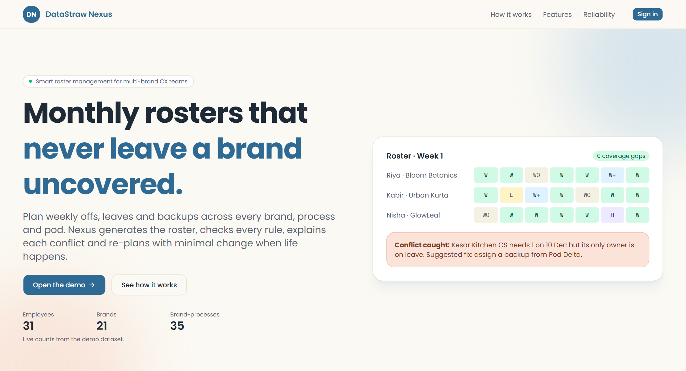
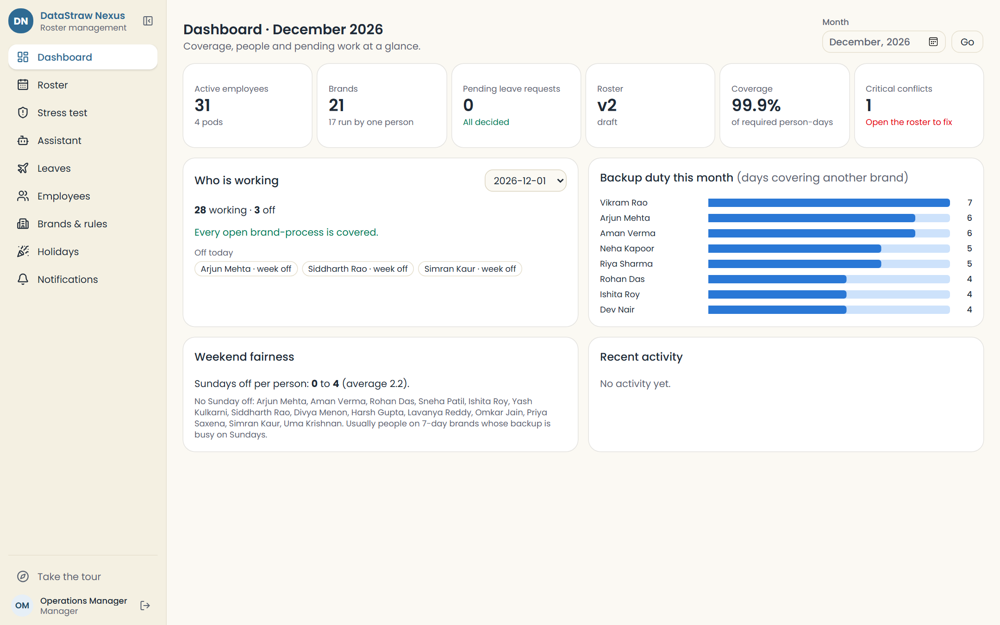
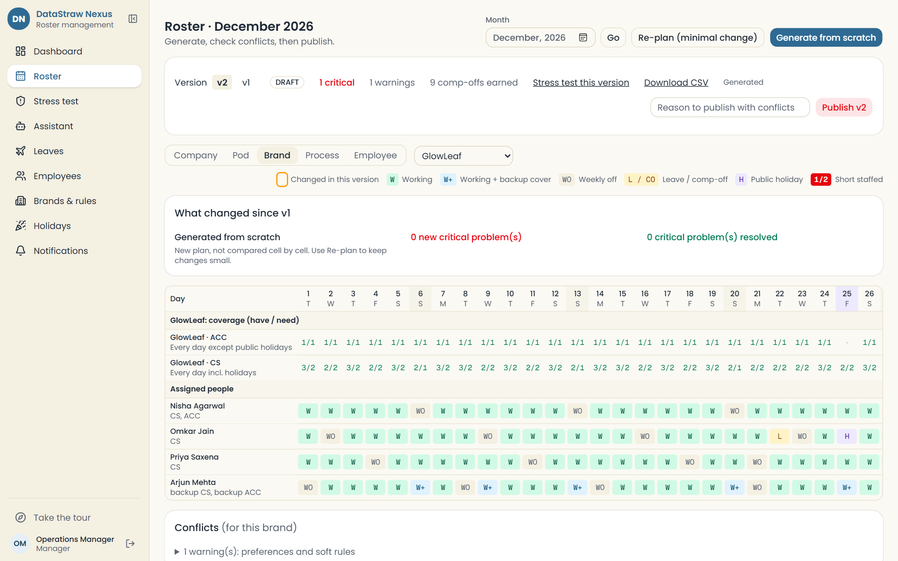
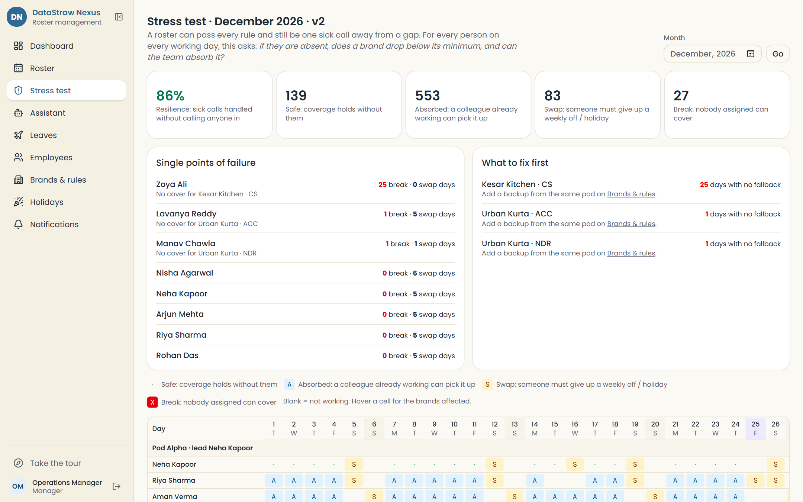
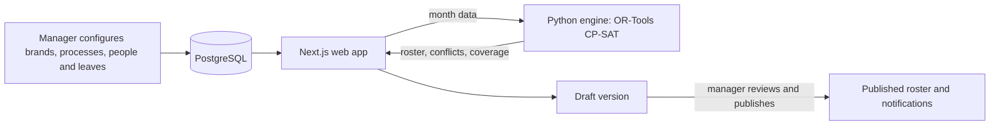

<div align="center">

# DataStraw Nexus

**Smart monthly roster management for multi-brand customer-experience teams.**

Generate, validate and publish rosters across brands, processes and pods, with clear conflict detection and minimal-change re-planning when plans change.

**[Live app](https://datastraw-nexus-469b.vercel.app)** · **[Engine API](https://datastraw-nexus-engine.onrender.com/health)** · Demo login: `manager@datastraw.demo` / `demo1234`



</div>

---

## Live links

| | URL |
|---|---|
| **Web app** (Next.js on Vercel) | https://datastraw-nexus-469b.vercel.app |
| **Scheduling engine** (FastAPI + OR-Tools on Render) | https://datastraw-nexus-engine.onrender.com ([health check](https://datastraw-nexus-engine.onrender.com/health)) |

> The engine runs on Render's free tier, which sleeps after 15 minutes idle. The first **Generate** after a pause can take up to a minute; if it times out, refresh and try again. The engine is an API, so its root URL shows `Not Found`; use `/health` to check it.

## What is this?

An operations team supports many D2C brands. Each brand runs several processes (Customer Support, Abandoned Cart Conversions, NDR, Retention) and each process has its own working days: some run 365 days a year, some take public holidays off, some also take Sundays off. Most brands are handled by a single person, so one badly placed weekly off can leave a brand with nobody.

**DataStraw Nexus** plans the whole month for the whole team. It decides who works and who is off on every day, makes sure every brand-process has enough people, explains any problem in plain words, and adapts the roster with as few changes as possible when someone takes leave.

It solves the scheduling problem itself: it is not a calendar or a digitised spreadsheet.

## Key features

| | |
|---|---|
| **Per-process rules** | Each brand-process has its own calendar (365 days / no public holidays / no Sundays and holidays) and minimum staff, including per-weekday minimums. |
| **Automatic roster generation** | A constraint solver plans weekly offs, leaves, comp-offs and backup cover for every person-day of the month. |
| **Independent validation** | A separate checker re-reads any roster (generated or hand-edited) and lists every conflict with suggested fixes. |
| **Minimal-change re-planning** | Approve or cancel a leave and the roster is re-planned, changing as few cells as possible. Past days stay locked. |
| **Five roster views** | Company, pod, brand, process and employee, with daily coverage shown as *have / need*. |
| **N-1 stress test** | For every person on every working day: *if they call in sick, does a brand break, and can the team absorb it?* Finds single points of failure before they happen. |
| **AI assistant with guardrails** | Ask "who is off on the 15th?" or "why is Kesar Kitchen short?". It can only **propose** changes; nothing happens until the manager confirms. |
| **Drafts, versions and publishing** | Every change is a new draft version. Publishing re-checks against today's rules, notifies employees and requires a written reason if conflicts remain. |
| **Roles** | Managers plan and publish. Employees see their own published roster and request leave. |
| **CSV export** | Download any roster version with per-day coverage, ready for Excel or Google Sheets. |

## Screenshots

**Dashboard:** coverage, pending work, backup load and weekend fairness at a glance.



**Brand view:** daily coverage (*have / need*) per process, and everyone assigned to the brand.



**Stress test:** what happens if any one person is absent.



## How it works



1. **Configure:** pods, employees, brands, processes, calendars, minimum staff, assignments (primary or backup), holidays and leaves. All of it is editable in the app; no code changes needed.
2. **Generate:** the engine turns the month into a constraint problem and solves it.
3. **Validate:** an independent checker reviews the result cell by cell and computes coverage for every brand-process and day.
4. **Adapt:** when something changes, the roster is re-planned with minimal change and saved as a new version. The manager reviews and publishes.

## Tech stack

| Layer | Technology |
|---|---|
| Web app | Next.js 16 (App Router, Server Actions), React 19, TypeScript |
| UI | Tailwind CSS 4, shadcn/ui, Lucide icons, Poppins |
| Database | PostgreSQL on Neon, Drizzle ORM and migrations |
| Scheduling engine | Python 3.11, Google OR-Tools (CP-SAT), FastAPI |
| AI assistant | Google Gemini with function calling (optional) |
| Auth | Email + password (scrypt), signed session cookie |

## Run it locally

**Requirements:** Node.js 20.9+, Python 3.11+, and a PostgreSQL database (a free [Neon](https://neon.tech) project works).

```bash
# 1. Install the web app
git clone https://github.com/saniyacodes06/Datastraw-Nexus.git
cd Datastraw-Nexus
npm install

# 2. Configure environment
cp .env.example .env.local      # then fill in DATABASE_URL and AUTH_SECRET

# 3. Create tables and load the sample data
npm run db:migrate
npm run db:seed
```

```bash
# 4. Start the scheduling engine (in a second terminal)
cd engine
python -m venv .venv
source .venv/bin/activate        # Windows: .venv\Scripts\activate
pip install -r requirements.txt
uvicorn api:app --port 8000
```

```bash
# 5. Start the web app
npm run dev
```

Open http://localhost:3000.

### Demo accounts

All accounts use the password **`demo1234`** (set by `DEMO_PASSWORD`).

| Role | Email |
|---|---|
| Operations manager | `manager@datastraw.demo` |
| Employee (example) | `riya.sharma@datastraw.demo` |

Every employee can sign in with their own email; the login page lists a few. To try the flow: sign in as manager, open **Roster** and click **Generate roster** for December 2026.

### Environment variables

| Variable | Purpose |
|---|---|
| `DATABASE_URL` | PostgreSQL connection string |
| `AUTH_SECRET` | Signs session cookies (required in production) |
| `ENGINE_URL` | Where the Python engine runs (default `http://127.0.0.1:8000`) |
| `ENGINE_KEY` | Shared secret between web app and engine (set the same value on both in production) |
| `MANAGER_EMAIL` / `MANAGER_PASSWORD` | Manager sign-in (password required in production) |
| `DEMO_PASSWORD`, `SHOW_DEMO_LOGINS` | Demo password for seeded employees, and whether the login page lists them |
| `GEMINI_API_KEY` | Optional. Turns on the AI assistant; everything else works without it |

## Sample data and assumptions

The seeded dataset is fictional and built to show realistic staffing patterns:

- **31 employees, 4 pods, 21 brands, 35 brand-processes.**
- **17 of 21 brands (81%) have one dedicated employee** who handles all their processes.
- The remaining brands show the other patterns: **split processes** (Urban Kurta: CS, ACC and NDR each have their own person), a **shared process** (GlowLeaf CS needs 2 people on weekdays, 1 on Sunday) and **overlap** (FitFuel: two people share CS, one also does Retention).
- Single-brand owners back each other up in a ring inside their pod; each **pod lead** can back up to 2 brands a day.
- **Kesar Kitchen** is a new brand with no backup yet, so its owner's leave creates a real, unavoidable gap. This is deliberate, to show conflict detection.
- Public holidays: 25 Dec, 1 Jan, 26 Jan.

**Assumptions** (all configurable in the app):

- Planning is per day (working or off), not per hour or shift.
- Each full Monday–Sunday week gives exactly one weekly off. A day the person's brands are closed anyway counts as that off.
- Nobody works more than 6 days in a row by default (per-employee setting), including days carried over from the previous month.
- Working on a public holiday earns a comp-off.
- A backup covers at most 1 extra brand per day by default (2 for pod leads).

## Project structure

```
app/
  (site)/            public pages: landing (/) and login
  (app)/             signed-in app: dashboard, roster, stress test, assistant,
                     leaves, employees, brands & rules, holidays, notifications
  actions.ts         every write (server actions), validated with zod
components/          roster grid, sidebar, tour, assistant chat, landing page
lib/                 engine bridge, roster views, stress test, auth, assistant tools
db/                  schema, migrations, seed data
engine/
  roster/rules.py    shared rule book (used by solver AND validator)
  roster/solver.py   CP-SAT model
  roster/validator.py independent checker + fix suggestions
  api.py             FastAPI service
  tests/             engine tests
scripts/             end-to-end and safety checks
```

## Tests and checks

```bash
cd engine && pytest                 # solver + validator tests
npm run check:resilience            # stress-test logic (no database needed)
npm run check:flows                 # leave → re-plan → cancel → weekly-off swap (DB + engine)
npm run check:concurrency           # two managers at once, double submits, sign-in lockout
npm run check:assistant-live        # AI guardrails against the real Gemini API
```

The database-backed checks clean up everything they create.

## Design decisions

### 1. How are employees, brands, processes, pods and their relationships modelled?

The unit of coverage is the **brand-process** (for example *GlowLeaf · CS*). It carries the operating calendar and the minimum staff, so two processes of the same brand can follow different rules. **Assignments** link employees to brand-processes as `PRIMARY` or `BACKUP`, many-to-many, so one person can work several brands and one process can have several people. **Employees** belong to a **pod** (which has a pod lead) and carry their own preferences: preferred day off, max days in a row and how many extra brands they can back up. A brand's operating calendar and a person's working schedule are separate things: the calendar says when a brand-process needs people, the roster says when each person works. Rosters are stored as versioned JSON with their conflicts and coverage.

### 2. How is a roster generated, and how do you know it satisfies the constraints?

The month becomes a CP-SAT model with one yes/no decision per person per day (plus "is this backup covering that brand today"). **Hard rules** are never broken: approved leave, one weekly off per full week, max consecutive days, backup limits. **Soft rules** carry penalties, heaviest first: a missing person on a required day costs 1000, a missed preferred day off 20, unfair Sunday distribution 5, working a holiday 3. The solver minimises the total, deterministically. Then an **independent validator**, which shares the rule definitions but not the solver's logic, re-reads the roster cell by cell and reports every problem. The same validator checks hand-edited rosters, so a manual change is held to the same standard.

### 3. How are single-resource brands treated differently from multi-employee brands?

The same model handles both: coverage is always counted per brand-process. For multi-employee brands, split processes and shared processes fall out naturally from the assignments and minimum staff. Single-owner brands are the fragile case, so the sample data gives every owner a backup inside their pod, and the pod lead can cover up to two brands a day. The **stress test** then shows which single-owner brands still have days with no fallback.

### 4. What happens when the only person on a brand is unavailable on a required day?

Approving the leave triggers a minimal-change re-plan. The solver first tries to bring in an assigned backup who is already working (shown as `W+`). If that isn't possible, it can move someone's weekly off. If nobody assigned can cover, the gap is **kept and flagged as CRITICAL**, never hidden, with the status of every assigned person and concrete suggestions: move a weekly off, add a backup from the same pod, or lower the minimum for that day. Kesar Kitchen in the sample data demonstrates exactly this case.

### 5. How are conflicting requirements and insufficient staffing handled?

Coverage is a very heavily weighted soft rule rather than a hard rule, so the engine always returns the best possible roster and states exactly what is short, instead of failing with "no solution". Preferences have much lower weight, so a required client day always wins over a preferred day off; missed preferences are reported as warnings. If the hard rules themselves cannot be met, the engine returns a clear error. A roster with critical conflicts can only be published with a written reason, which is stored on the version.

### 6. What is automated, and what is left to humans? Why?

**Automated:** generation, validation, coverage maths, re-planning after leave decisions, the stress test, notifications and change highlighting. **Human-controlled:** publishing, approving or cancelling leave, manual edits, rule changes, and every action the AI assistant suggests (it can only propose). Client commitments and people's days off are accountable decisions, so the tool does the heavy calculation and explains its reasoning, and a manager makes the call.

### 7. What would change if the team and brand count doubled?

The model itself scales: about 60 people and 40 brands is still small for CP-SAT. The changes would be operational: solve **per pod** in parallel (pods are mostly independent, with cross-pod backups as the link), run solves as **background jobs** instead of inside the request, give pod leads their own approval step, move the sign-in lockout from memory to the database, and virtualise the roster grid for faster rendering.

### 8. With one more week, what would come first?

1. **Shifts and hours** instead of day-level planning, so overlapping responsibilities and incompatible shifts can be checked directly.
2. **Side-by-side comparison** of alternative roster plans (for example "fairness first" against "fewest changes").
3. A **pod-lead approval workflow** before the operations manager publishes.
4. **Docker and CI**, so every commit runs the engine tests and checks automatically.

## Roadmap

- [x] Public deployment (web app on Vercel, engine on Render)
- [ ] Shift-level scheduling
- [ ] Alternative plan comparison
- [ ] Pod-lead approvals
- [x] Docker setup (`docker compose up --build`)
- [ ] CI

---

<div align="center">
Built as the DataStraw Tech internship assessment · Demo data is fictional · Developed with Claude Code as an AI pair-programmer
</div>
